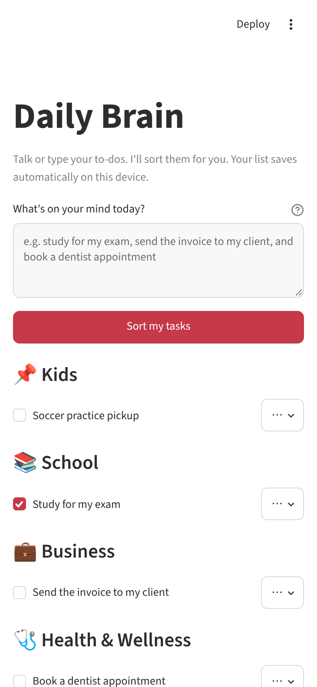

# Daily Brain

**A mobile-friendly web app that turns a spoken or typed brain dump into an organized to-do list, sorted into School, Business, Health & Wellness, Work, Personal, or categories you create.**

**Try it:** _live link coming soon_



---

## Overview

Juggling school, work, health, and side projects means to-dos pile up everywhere. Typing them into an app one at a time takes effort, and that effort is exactly what makes people stop using to-do apps.

Daily Brain lets you **say or type your whole list at once**. It splits what you said into separate tasks and sorts each one into the right part of your life automatically.

## Goals

- Make capturing tasks as effortless as possible, including by voice
- Work on any device, especially phones
- Keep people's tasks private, and never lose them
- Build a foundation for an AI assistant that learns your schedule (see [Future Features](#future-features))

## Features

- **Talk or type.** On a phone, tap the mic on your keyboard and speak your list
- **Brain-dump splitting.** "study for my exam, email my professor and buy milk" becomes 3 separate tasks
- **Auto-sorting** into School, Business, Health & Wellness, Work, and Personal
- **Create your own categories** with your own keywords (for example, "Kids: soccer, daycare")
- **Keep things together.** Teach it phrases that should never be split, like "lemon pepper and garlic blend"
- **Check tasks off** and clear completed ones
- **Fix mistakes.** Move a task to a different category or delete it
- **Auto-save.** Your list saves on your device as you go, so closing the page by accident loses nothing
- **Backup and restore** to move your list to another device
- **Private by design.** Nothing is stored on a server

## Example

**You say:**
> "I need to study for my exam, send the invoice to my client, book a dentist appointment, team meeting at 3, and pick up groceries"

**Daily Brain shows:**
```
School              [ ] Study for my exam
Business            [ ] Send the invoice to my client
Health & Wellness   [ ] Book a dentist appointment
Work                [ ] Team meeting at 3
Personal            [ ] Pick up groceries
```

## How It Works

1. **Splitting.** The text is split on commas, sentence-ending periods, new lines, and "as well as." It splits on "and" only when both sides have at least two words, so "email my professor and call mom" becomes two tasks while "buy salt and pepper" stays one. Phrases in your "keep together" list are never split, and titles like "Dr." don't end a task.
2. **Cleaning.** Filler people say out loud ("ok so," "let's add," "I need to," "and then") is removed.
3. **Sorting.** Each task is checked against keyword lists. Matching is whole-word only, so "re**call** my notes" is *not* mistaken for "call." Simple plurals count ("exams" matches "exam").
4. **First match wins.** Your own categories are checked first, then School → Business → Health & Wellness → Work. A task only goes to **Personal** if nothing else matches.
5. **Saving.** Your list is stored in your browser's local storage, a small private space every browser gives each website. It stays on your device and never reaches a server.

| Category | Keywords |
|---|---|
| School | exam, homework, study, class, lecture, assignment, quiz, professor |
| Business | invoice, client, order, product, grant, funding, sponsor |
| Health & Wellness | doctor, dentist, appointment, checkup, therapy, pharmacy, prescription, workout, gym, yoga, meditate, vitamins |
| Work | meeting, shift, report, email, deadline, project, call |
| Personal | everything else |

## Tech Stack

- **Python**
- **Streamlit** (turns Python into a web app that works on phones)
- **Regular expressions** for whole-word matching and text splitting
- **JavaScript** (a small Streamlit component) for saving to the browser
- **JSON** for saving, backups, and restoring

## Run It on Your Computer

```bash
git clone https://github.com/andreaagore77/Daily-Brain.git
cd Daily-Brain
pip install -r requirements.txt
streamlit run app.py
```
Then open the link it prints (usually `http://localhost:8501`).

## Project Structure

```
Daily-Brain/
├── app.py             # The web app: brain-dump box, task list, auto-save, settings
├── categories.py      # Keyword lists, sorting rule, and brain-dump splitter
├── requirements.txt   # Python packages the app needs
├── phone-preview.png  # Screenshot used in this README
└── README.md
```

## Known Limitations

- Keyword rules can't understand meaning. "Call mom" is sorted as **Work** because of the word "call." You can move it with the ⋯ menu.
- Splitting on "and" can still guess wrong with longer phrases ("salt and pepper grinder"). Add the phrase to "Keep these together" and it won't happen again.
- Your list lives in one browser on one device. Clearing your browser data erases it, so download a backup now and then.

These limits are the reason for version 2 below.

## Future Features

**Version 2**
- A built-in record button using AI speech-to-text
- AI sorting (an LLM) instead of keywords, so "call mom" lands in Personal
- Optional accounts, so your list syncs across your phone and laptop

**The bigger vision: an AI "life secretary"**
- Learns your schedule through voice, text, or video
- Sends reminders for appointments, deadlines, weather, and news
- Works on wearables like smart glasses

## About

Built by **Andrea A. Gore**, Computer & Data Science student and Break Through Tech Fellow.

Built with AI-assisted coding.
